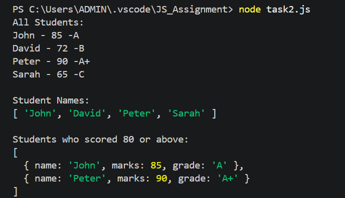
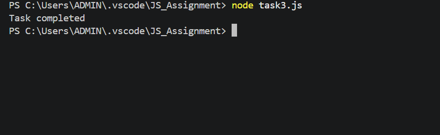

# JavaScript Assignment - Functions, Arrays & Asynchronous JS

## Program Descriptions
- **Task 1:** Processes test results using regular functions, arrow functions, and `for...of` loops.
- **Task 2:** Utilizes array methods like `forEach()`, `map()`, and `filter()` to manipulate student data.
- **Task 3:** Covers asynchronous JavaScript concepts including Callbacks, Promises, and Async/Await.

## Execution Steps
1. Make sure Node.js is installed on your system.
2. Open the project folder in terminal or VS Code.
3. Run Task 1 using: `node task1.js`
4. Run Task 2 using: `node task2.js`

## Screenshots Reference
task1.js

PS C:\Users\ADMIN\.vscode\JS_Assignment> node task1.js
Anu - Pass
Rahul - Fail
Meena - Pass
Arun - Fail

task2.js

PS C:\Users\ADMIN\.vscode\JS_Assignment> node task2.js             
All Students:
John - 85 -A
David - 72 -B
Peter - 90 -A+
Sarah - 65 -C

Student Names:
[ 'John', 'David', 'Peter', 'Sarah' ]

Students who scored 80 or above:
[
  { name: 'John', marks: 85, grade: 'A' },
  { name: 'Peter', marks: 90, grade: 'A+' }
]

task3.js

PS C:\Users\ADMIN\.vscode\JS_Assignment> node task3.js
Task completed
PS C:\Users\ADMIN\.vscode\JS_Assignment> 

